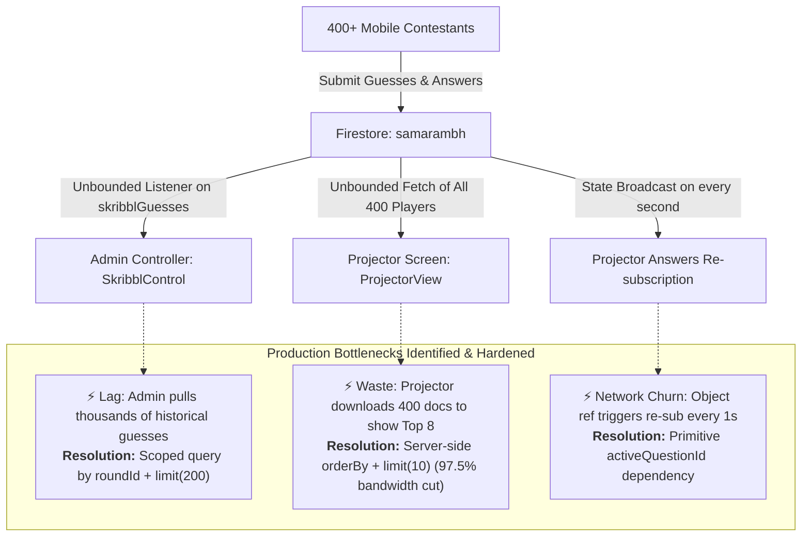

# TechArena: Real-Time Multi-Mode Competitive Quiz Platform

TechArena is a high-performance, real-time competitive gaming and evaluation platform engineered for college tech events and mega-hackathons (such as *SAMARAMBH*). It features seamless mode switching between Solo and Team play, an extensible challenge architecture (MCQs, Terminal Hacks, Photo Recognition, Logic Puzzles), and pro latency-based scoring.

---

## ⚡ Concurrency & Event-Scale Architecture (400+ Live Students)

Engineered and hardened to withstand **400+ students playing and submitting answers simultaneously** without UI freezes, race conditions, or quota exhaustion.

### 🏗️ Event Concurrency & Bottlenecks Hardening Pipeline



### 🔬 Core Production Bottlenecks & Code-Level Solutions

| Bottleneck Identified | Impact at 400+ Scale | Root Cause | Engineering Solution Implemented |
| :--- | :--- | :--- | :--- |
| **1. Unbounded Skribbl Listener** | Severe admin controller lag, high memory consumption, and quota spikes after round 2. | `onSnapshot(GUESSES_COL)` listened globally across all rounds without bounds, downloading thousands of historical chat records. | Scoped query strictly to active round: `where('roundId', '==', activeRound.roundId)` with `limit(200)` and automatic listener teardown on round swap. |
| **2. Projector Leaderboard Over-fetching** | Sluggish stage updates, high mobile hotspot latency, and 400 document reads per update. | Stage projector downloaded every single player document in the collection just to sort and slice the top 8 in client JS. | Converted to server-side query: `orderBy('score' / 'totalScore', 'desc')` bounded to `limit(10)`. Bandwidth overhead reduced by **97.5%**. |
| **3. Projector Subscription Churn** | Continuous WebSocket connection reconnect loops and Firestore subscriber churn. | `useEffect` depended on `gameState.activeQuestion` object reference. Because timer ticks re-generated the object every second, the listener destroyed and re-created every 1000ms. | Extracted stable primitive `activeQuestionId = gameState?.activeQuestion?.id` as the sole effect trigger, completely eliminating subscriber churn. |

### 🛡️ Platform Resilience Matrix

| Feature / Mechanism | Before (Standard Implementation) | Now (Optimized Event Architecture) |
| :--- | :--- | :--- |
| **Authentication & PINs** | 4-digit PINs (`1000`–`9999`) had a **99.986% collision risk** for 400 players, causing student profiles to overwrite each other. | Upgraded to **6-digit PINs** (900,000 combinations) with an atomic 5-attempt Firestore existence retry loop. Zero collisions. |
| **Score Calculation** | Sequential `for` loop awaiting 400 individual updates froze the host dashboard and stage display for **45–60 seconds**. | Replaced with Firestore `writeBatch` chunking (< 400 ops) and in-memory squad pre-aggregation. All scores commit in **< 500ms**. |
| **Offline Resilience** | Sync listeners died when question views unmounted; campus Wi-Fi drops permanently lost queued answers. | Global background sync manager in `GameContext` flushes offline queues on reconnect. Deterministic doc IDs (`${qId}_${playerPin}`) ensure **100% idempotent** submissions. |
| **Timer Zero Forfeiture** | Hesitating or tapping submit right as time expired caused answers to be discarded. | **Auto-submit on timer expiry**: Any selected option or typed command automatically locks and submits at `0s`. Clamped countdown logic prevents mobile clock drift. |
| **Firestore Read Quota** | 400 mobile phones listening to all 400 player docs generated **160,000 reads/round**, risking instant quota shutdown. | Mobile leaderboards capped to `limit(50)` (~90% read reduction). Student's individual rank and score stream live via direct document snapshot. |
| **Review Page Latency** | Full collection queries on round end caused lag and extra reads. | **0ms local storage resolution** with zero network reads, falling back to deterministic document fetch. Displays correct answer for incorrect submissions. |
| **Crash Protection** | Uncaught React render exceptions produced a blank white screen of death. | Global React `ErrorBoundary` shields the application, offering one-click session recovery. |
| **Session Continuity** | Joining or creating squads triggered `window.location.reload()`, killing live state and websocket connections. | Removed disruptive page reloads; roster updates stream seamlessly via reactive auth context with self-serve **Leave Squad** capabilities. |
| **Mobile Guessing UX** | Submitting guesses disabled the `<input>`, collapsing the on-screen keyboard on iOS and Android. | Preserved input focus continuously during submission without blurring or closing mobile keyboards. Inline shake pill feedback on incorrect attempts. |

---

## Architectural Overview

TechArena operates on a 3-tier real-time sync model powered by Firebase:
1. **Admin CMS & Live Controller:** Allows hosts to build challenge blocks by round, flag used questions to prevent duplication, push questions live globally, and trigger stage overrides.
2. **Cinematic Projector View:** Features a dual-phase suspense gatekeeper countdown, active question windows, live submission counter, and cyber-themed podium leaderboards.
3. **Mobile Player Controller:** A responsive mobile interface with haptic feedback, real-time standings, device-sync PIN persistence, and squad roster management.

---

## Tech Stack

* **Frontend:** React 19, Tailwind CSS v4, Framer Motion, Lucide React
* **Backend & Real-Time Sync:** Firebase (Firestore, Authentication, Real-Time Listeners)
* **Build Tool:** Vite v8

---

## 🧩 How to Add a New Game Type (e.g., Phishing Mail Recognition)

If you want to introduce a brand new interactive game mode to TechArena, follow this 3-step blueprint:
1. **Admin CMS (`src/pages/admin/AdminDashboard.jsx`):** Register the new challenge type name in the dropdown and add form inputs to capture its content payload (e.g., email text and correct answer).
2. **Mobile Router (`src/pages/mobile/MobileController.jsx`):** Add a matching `case` in the switch statement to intercept the new block type when pushed live.
3. **Mobile View (`src/pages/mobile/components/PhishingUI.jsx`):** Build the student-facing interactive interface that submits the user's choice and timestamp back to the Firestore `answers` collection using `submitAnswerRecord`.

---

## 📂 Project Architecture

```text
techarena/
│
├── public/                     # Static assets (logos, videos, public images)
│
├── src/                        # Main source code directory
│   ├── config/
│   │   └── firebase.js         # Firebase initialization, persistent multi-tab cache, & Auth config
│   │
│   ├── components/
│   │   ├── ErrorBoundary.jsx   # Global React Error Boundary shielding against white-screen crashes
│   │   ├── GlassAvatar.jsx     # Translucent glass identity avatars with 16 colorways
│   │   ├── SkribblCanvas.jsx   # High-performance rAF canvas renderer with dirty-flag repaint loops
│   │   └── StageCountdown.jsx  # Synchronous countdown animation component with circular SVG telemetry
│   │
│   ├── context/
│   │   ├── AuthContext.jsx     # Collision-resistant 6-digit PIN auth, reactive player snapshot, session persistence
│   │   └── GameContext.jsx     # Global event state listener & background offline queue synchronization worker
│   │
│   ├── data/
│   │   └── skribblWords.js     # Curated technical vocabulary corpus for Skribbl drawing challenges
│   │
│   ├── hooks/
│   │   └── useSkribblStrokes.js # Reactive Firestore stroke segments listener with clean unmount resets
│   │
│   ├── pages/
│   │   ├── admin/
│   │   │   ├── AdminDashboard.jsx    # Admin CMS, challenge builder, question flagging, & sub-second writeBatch score calc
│   │   │   └── components/
│   │   │       ├── SkribblControl.jsx    # Word chooser, timed hints orchestrator, & bounded guess inspector
│   │   │       └── SkribblDrawCanvas.jsx # Operator pointer capture, distance filter, & quantized batch stroke transport
│   │   │
│   │   ├── projector/
│   │   │   ├── ProjectorView.jsx  # Stage display view with 5s countdown gate, active question screen, & podium leaderboards
│   │   │   └── components/
│   │   │       └── SkribblStage.jsx   # Auditorium cinema view: live canvas, progressive hints, and guess ticker
│   │   │
│   │   └── mobile/
│   │       ├── MobileController.jsx # Master router for mobile players (game interceptors, squad views, solo mode)
│   │       ├── PlayerLogin.jsx     # Student onboarding via name entry and 6-digit collision-resistant PIN
│   │       ├── PlayerDashboard.jsx # Quota-protected leaderboard (limit 50), live personal rank, & session controls
│   │       ├── TeamLobby.jsx       # Zero-reload squad creation, join code input, live roster, & self-serve Leave Squad
│   │       │
│   │       └── components/
│   │           ├── QuizUI.jsx        # Standard MCQ grid with haptic feedback & timer-expiry auto-submit
│   │           ├── TerminalUI.jsx    # Terminal console shell challenge view for coding missions
│   │           ├── PhotoQuizUI.jsx   # Visual image identification challenge interface
│   │           ├── PuzzleUI.jsx      # Logic puzzle and riddle text submission interface
│   │           ├── SkribblUI.jsx     # Guessing bar with continuous keyboard focus & locked state view
│   │           └── PlayerRoundReview.jsx # 0ms local storage round review with verified correct answer display
│   │
│   ├── utils/
│   │   ├── offlineSync.js      # Idempotent answer submission & persistent offline queue storage
│   │   └── skribblEngine.js    # Cyrb53 hashing, salt generation, progressive hint masks, & stroke codecs
│   │
│   ├── App.jsx                 # Route switchboard wrapped in global ErrorBoundary
│   ├── main.jsx                # React entry point wrapping app with Auth & Game contexts
│   └── index.css               # Global Tailwind CSS styles and custom animations
│
├── firestore.rules             # Production security rules for events, players, answers, strokes, & guesses
├── .env                        # Local environment variables (Firebase API keys - excluded from git)
├── .gitignore                  # Git ignore rules (node_modules, dist, .env)
├── package.json                # Project dependencies (React, Firebase, Framer Motion, Tailwind)
├── README.md                   # Project documentation & collaborator local setup guide
└── vite.config.js              # Vite bundler configuration
```

---

## Getting Started on Your Local Machine

Follow these steps to clone and run TechArena locally for development or testing:

### 1. Clone the Repository
Open your terminal and run:
```bash
git clone https://github.com/DEMOCODE675/TechArena.git
cd TechArena
```

### 2. Install Dependencies

```bash
npm install
```

### 3. Configure Environment Variables
Create a file named `.env` in the root directory of the project and add your Firebase project credentials:

```env
VITE_FIREBASE_API_KEY=your_api_key_here
VITE_FIREBASE_AUTH_DOMAIN=your_auth_domain_here
VITE_FIREBASE_PROJECT_ID=your_project_id_here
VITE_FIREBASE_STORAGE_BUCKET=your_storage_bucket_here
VITE_FIREBASE_MESSAGING_SENDER_ID=your_messaging_sender_id_here
VITE_FIREBASE_APP_ID=your_app_id_here
```

### 4. Run the Development Server

```bash
npm run dev
```

---

## How to Test Locally (Simulating a Live Event)

Open three separate browser windows (or split view):

* **Window 1** (`http://localhost:3000/admin`): Admin control panel to push challenges live and run batched score calculation.
* **Window 2** (`http://localhost:3000/projector`): Stage display for the audience showing synced countdowns and leaderboards.
* **Window 3** (`http://localhost:3000/play`): Register as a player using a 6-digit PIN to test real-time answer locking, auto-submission on timer expiry, and instant round reviews.
